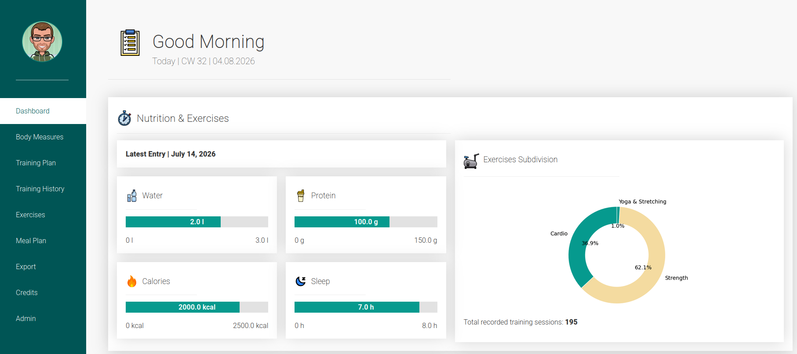

# Django Fitness Dashboard



A personal fitness tracking dashboard built with Django. The application combines workout planning, seven-day training cycles, training history, body measurements, nutrition tracking, daily meal suggestions, exercise management, progress charts, and PDF reporting in one interface.

## Features

- Track body measurements such as weight, waist, chest, and arm circumference
- Create predefined training plans
- Configure repeating seven-day training cycles with a flexible start date, an optional end date, reusable training-plan assignments, and rest days
- View the current training cycle on the dashboard, with today’s training day highlighted
- Record improvised and plan-based workouts
- Store exercises with muscle group and equipment information
- Track sets, repetitions, weights, duration, and notes
- Monitor nutrition, water intake, protein, calories, and sleep
- Manage meals by category (breakfast, lunch, snack, and dinner), including ingredients
- Show one date-seeded, pseudo-random meal suggestion per category on the dashboard
- Display progress charts generated with Matplotlib
- Export dashboard data as PDF
- Manage content through the Django administration interface
- Embed fitness-related YouTube channels and playlists
- Responsive frontend with custom SCSS and JavaScript components

## Dashboard Highlights

### Training Cycle

Training cycles are configured in the Django administration interface. Each cycle has a title, a start date, an optional end date, and seven consecutive slots (`day_1` through `day_7`). Each slot can refer to an existing training plan or remain empty to represent a rest day. The seven-day schedule repeats automatically from the start date until the optional end date; leaving the end date empty enables indefinite repetition. A cycle can begin on any weekday.

The dashboard displays the current seven-day cycle with abbreviated weekdays and assigned training-plan names. Today’s row is highlighted. Detailed exercises remain available in the Training Plan section.

### Today's Meal Plan

The dashboard presents a compact menu with one suggested recipe from each of four categories: breakfast, lunch, snack, and dinner. Suggestions use a date-seeded pseudo-random selection, so repeated page loads on the same day yield the same selection **as long as the recipe collection and its ordering do not change**. A new date generates a new selection, although individual recipes may repeat by chance.

The dashboard shows recipe names only; full ingredients are available on the Meal Plan page. Empty categories can display a fallback message instead of a recipe.

Both widgets are intended as dashboard conveniences rather than report content. They are not part of the intended PDF report layouts.

## Pages and Templates

| Page / Template | Description |
| --- | --- |
| **Dashboard** (`dashboard.html`) | Main overview with training statistics, nutrition and exercise summaries, progress charts, the current repeating **Training Cycle**, and **Today's Meal Plan** suggestions. |
| **Training Plan** (`training_plan.html`) | Create and review planned workout routines and exercise assignments; view configured weekly splits. |
| **Training History** (`training_history.html`) | Review logged workouts, including planned and improvised sessions, sets, repetitions, and weights. |
| **Body Measures** (`body_measures.html`) | Track body weight and circumference measurements and visualize trends. |
| **Exercises** (`exercises.html`) | Browse the exercise library, organized by muscle groups and equipment. |
| **Meal Plan** (`meal_plan.html`) | Browse meals by breakfast, lunch, snack, and dinner, including ingredients. |
| **Export** (`export.html`) | Generate PDF reports for the dashboard, measurements, plans, training history, meals, or a combined report. The two new dashboard-only widgets are excluded. |
| **Credits** (`credits.html`) | Attribution and credits for the project. |
| **Base layout** (`base.html`) | Shared page layout and navigation used by the application templates. |

PDF-specific templates are organized separately under `tracker/templates/tracker/reports/` and its `sections/` directory.

## Technologies

- Python
- Django
- SQLite
- HTML
- SCSS / CSS
- JavaScript
- Matplotlib
- WeasyPrint
- Gunicorn
- WhiteNoise
- Docker

## Installation

Clone the repository:

```bash
git clone <repository-url>
cd django_FitnessDashboard
```

Create and activate a virtual environment:

```bash
python -m venv .venv
source .venv/bin/activate
```

Install the dependencies and create your local environment file:

```bash
pip install -r requirements.txt
cp .env.example .env
```

Apply the database migrations:

```bash
cd FitnessDashboard
python manage.py migrate
```

Create an administrator account:

```bash
python manage.py createsuperuser
```

Start the development server:

```bash
python manage.py runserver
```

Open the application in your browser:

```text
http://127.0.0.1:8000
```

## SCSS Development

Install the Node.js dependencies:

```bash
npm install
```

Compile SCSS once:

```bash
npm run sass:build
```

Or start the SCSS watcher while developing:

```bash
npm run sass:watch
```

The SCSS pipeline generates CSS assets. Use the scripts defined in `package.json`.

## Docker Deployment

From the repository root:

```bash
cp .env.docker.example .env.docker
docker build -t fitness-dashboard:latest .
docker run --rm --env-file .env.docker -p 8080:8080 fitness-dashboard:latest
```

The Docker image sets `DJANGO_ENV=docker`. Runtime configuration and secrets are supplied through environment variables; do not bake `.env` files or secrets into the image. The SQLite database is excluded from the image. For persistence, provide a writable volume or bind mount and run database migrations against the persistent database before launching the application.

The default Docker configuration assumes HTTPS termination through the configured reverse proxy (Zoraxy). Direct HTTP access to the container may be redirected to HTTPS. For local container testing without a reverse proxy, adjust the HTTPS-related environment settings accordingly.

## Project Status

FitnessDashboard is a personal learning and portfolio project. The core tracking, planning, charting, administration, and reporting functions are implemented. The repeating training-cycle widget (with an optional end date) and the date-based meal-suggestion widget have also been added to the dashboard. Please note that the application is under continuous development, and further functionality, usability enhancements, and design improvements are planned for future releases.

## Disclaimer

FitnessDashboard is a **personal learning, demonstration, and portfolio project**. It is not intended as a production-ready fitness, nutrition, or medical service, and its training or meal suggestions should not be treated as individualized health advice.

The included **demo data is synthetic and was generated with the assistance of ChatGPT**. It is intended only to demonstrate the application's functionality and should not be interpreted as real user records or verified nutrition or exercise guidance.

## Author

Developed by Deniz Inan.
