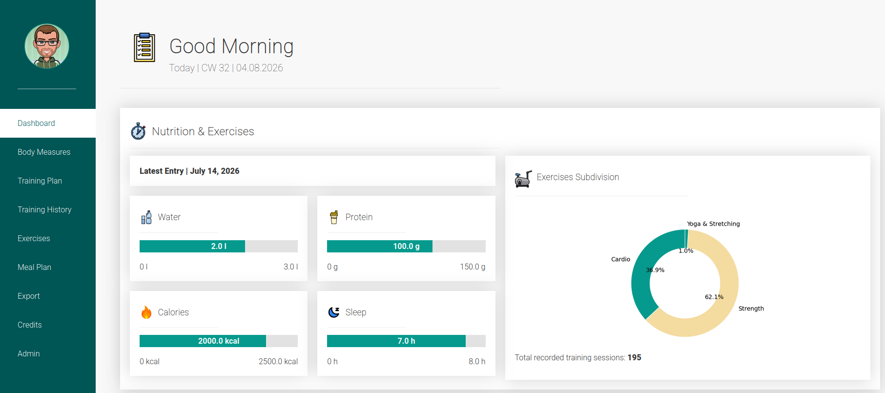

# Django Fitness Dashboard



A personal fitness tracking dashboard built with Django. The application combines workout planning, training history, body measurements, nutrition tracking, exercise management, progress charts, and PDF reporting in one interface.

## Features

- Track body measurements such as weight, waist, chest, and arm circumference
- Create predefined training plans
- Record improvised and plan-based workouts
- Store exercises with muscle group and equipment information
- Track sets, repetitions, weights, duration, and notes
- Monitor nutrition, water intake, protein, calories, and sleep
- Display progress charts generated with Matplotlib
- Export dashboard data as PDF
- Manage content through the Django administration interface
- Embed fitness-related YouTube channels and playlists
- Responsive frontend with custom SCSS and JavaScript components

## Technologies

- Python
- Django
- SQLite
- HTML
- SCSS / CSS
- JavaScript
- Matplotlib
- WeasyPrint
- Gunicorn
- WhiteNoise
- Docker

## Installation

Clone the repository:

```bash
git clone <repository-url>
cd django_FitnessDashboard
```

Create and activate a virtual environment:

```bash
python -m venv .venv
source .venv/bin/activate
```

Install the dependencies and create your local environment file:

```bash
pip install -r requirements.txt
cp .env.example .env
```

Apply the database migrations:

```bash
cd FitnessDashboard
python manage.py migrate
```

Create an administrator account:

```bash
python manage.py createsuperuser
```

Start the development server:

```bash
python manage.py runserver
```

Open the application in your browser:

```text
http://127.0.0.1:8000
```

## SCSS Development

Install the Node.js dependencies:

```bash
npm install
```

Start the SCSS watcher:

```bash
npm run sass:watch
```

This generates expanded and minified CSS files automatically.

From the repository root:

```bash
cp .env.docker.example .env.docker
docker build -t fitness-dashboard:latest .
docker run --rm --env-file .env.docker -p 8080:8080 fitness-dashboard:latest
```

The image sets `DJANGO_ENV=docker`. `settings.py` then enables WhiteNoise manifest static storage, HTTPS security settings, the reverse-proxy header, and the Docker host/origin defaults. The Dockerfile collects static assets during build using a temporary build key; runtime key comes from `--env-file`.

**Note:** With HTTPS redirection enabled, test the app through its configured HTTPS reverse proxy (Zoraxy), not directly on plain HTTP port 8080. For purely local container testing, adjust host, debug and HTTPS variables in `.env.docker` (including `DJANGO_SECURE_SSL_REDIRECT=false`, `DJANGO_SESSION_COOKIE_SECURE=false`, `DJANGO_CSRF_COOKIE_SECURE=false`, `DJANGO_SECURE_HSTS_SECONDS=0`).

Docker intentionally excludes `.env` files and `db.sqlite3` from the image. To persist SQLite data in Docker, mount a writable volume or bind mount at `/app/FitnessDashboard/db.sqlite3` (and ensure permissions for the non-root `django` user), and run database migrations separately before the server starts. The source ZIP's database is not removed.

Environment variables always override a root `.env` file. `.env.docker` is **not** read automatically; Docker injects it with `--env-file`. `DJANGO_ENV` is the only mode switch, and Docker already provides it. Never bake runtime secrets into the image.


Create the container environment file and build the image (from the repository root):

```bash
cp .env.docker.example .env.docker
docker build -t fitness-dashboard .
docker run --rm --env-file .env.docker -p 8080:8080 fitness-dashboard
```

The default Docker settings assume HTTPS termination by the configured Zoraxy reverse proxy on `fitness-dashboard.di-dev.de`; direct plain HTTP requests are redirected to HTTPS. Use the reverse proxy, or disable HTTPS-related settings in `.env.docker` for local container testing.

The SQLite database is excluded from the Docker image. Provide a persistent, writable volume and run migrations for Docker deployments.

## Project Status

This project is under active development and is used as a personal fitness tracking and portfolio application.

## Disclaimer

FitnessDashboard is a **demo and learning project** and must be used for personal and private usage only!

All included demo data is synthetic and was generated with ChatGPT.

## Author

Developed by Deniz Inan.
